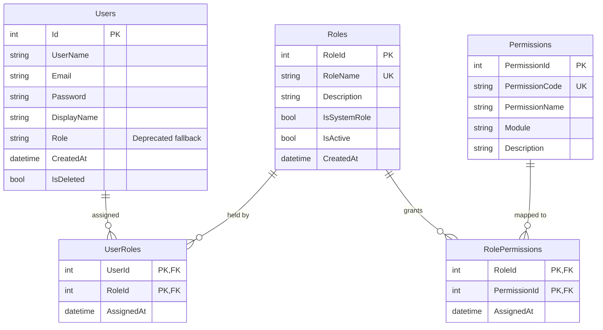

# Phase 1 Data Model: Dynamic RBAC & Database Schema Cleanup

**Feature**: `001-dynamic-rbac`  
**Date**: 2026-11-16  
**Status**: Completed  

---

## Entity Relationship Overview



---

## 1. Table Definitions & SQL DDL

### 1.1 `Roles` Table
Stores defined system and custom dynamic roles.

```sql
CREATE TABLE [dbo].[Roles] (
    [RoleId]       INT IDENTITY(1,1) NOT NULL,
    [RoleName]     NVARCHAR(50) NOT NULL,
    [Description]  NVARCHAR(250) NULL,
    [IsSystemRole] BIT NOT NULL CONSTRAINT [DF_Roles_IsSystemRole] DEFAULT (0),
    [IsActive]     BIT NOT NULL CONSTRAINT [DF_Roles_IsActive] DEFAULT (1),
    [CreatedAt]    DATETIME2(7) NOT NULL CONSTRAINT [DF_Roles_CreatedAt] DEFAULT (SYSUTCDATETIME()),
    CONSTRAINT [PK_Roles] PRIMARY KEY CLUSTERED ([RoleId] ASC),
    CONSTRAINT [UQ_Roles_RoleName] UNIQUE NONCLUSTERED ([RoleName] ASC)
);
```

### 1.2 `Permissions` Table
Stores all cataloged atomic permission operations.

```sql
CREATE TABLE [dbo].[Permissions] (
    [PermissionId]   INT IDENTITY(1,1) NOT NULL,
    [PermissionCode] NVARCHAR(100) NOT NULL,
    [PermissionName] NVARCHAR(100) NOT NULL,
    [Module]         NVARCHAR(50) NOT NULL,
    [Description]    NVARCHAR(250) NULL,
    CONSTRAINT [PK_Permissions] PRIMARY KEY CLUSTERED ([PermissionId] ASC),
    CONSTRAINT [UQ_Permissions_PermissionCode] UNIQUE NONCLUSTERED ([PermissionCode] ASC)
);
```

### 1.3 `RolePermissions` Table
Many-to-Many junction between `Roles` and `Permissions`.

```sql
CREATE TABLE [dbo].[RolePermissions] (
    [RoleId]       INT NOT NULL,
    [PermissionId] INT NOT NULL,
    [AssignedAt]   DATETIME2(7) NOT NULL CONSTRAINT [DF_RolePermissions_AssignedAt] DEFAULT (SYSUTCDATETIME()),
    CONSTRAINT [PK_RolePermissions] PRIMARY KEY CLUSTERED ([RoleId] ASC, [PermissionId] ASC),
    CONSTRAINT [FK_RolePermissions_Roles] FOREIGN KEY ([RoleId]) 
        REFERENCES [dbo].[Roles] ([RoleId]) ON DELETE CASCADE,
    CONSTRAINT [FK_RolePermissions_Permissions] FOREIGN KEY ([PermissionId]) 
        REFERENCES [dbo].[Permissions] ([PermissionId]) ON DELETE CASCADE
);
```

### 1.4 `UserRoles` Table
Many-to-Many junction between `Users` and `Roles`.

```sql
CREATE TABLE [dbo].[UserRoles] (
    [UserId]     INT NOT NULL,
    [RoleId]     INT NOT NULL,
    [AssignedAt] DATETIME2(7) NOT NULL CONSTRAINT [DF_UserRoles_AssignedAt] DEFAULT (SYSUTCDATETIME()),
    CONSTRAINT [PK_UserRoles] PRIMARY KEY CLUSTERED ([UserId] ASC, [RoleId] ASC),
    CONSTRAINT [FK_UserRoles_Users] FOREIGN KEY ([UserId]) 
        REFERENCES [dbo].[Users] ([Id]) ON DELETE CASCADE,
    CONSTRAINT [FK_UserRoles_Roles] FOREIGN KEY ([RoleId]) 
        REFERENCES [dbo].[Roles] ([RoleId]) ON DELETE CASCADE
);
```

---

## 2. Obsolete Tables Decommissioning

### 2.1 Dropping `WatchlistItems`
`WatchlistItems` was an old table pointing to discontinued movie IDs. `UserWatchLater` handles all active watchlist operations in `WatchLaterService.cs`.

```sql
IF OBJECT_ID(N'[dbo].[WatchlistItems]', N'U') IS NOT NULL
BEGIN
    DROP TABLE [dbo].[WatchlistItems];
END;
```

---

## 3. C# Entity Framework Core Models

### 3.1 `Role.cs` (`DotNetProject.Database.AppDbModels`)
```csharp
namespace DotNetProject.Database.AppDbModels;

public partial class Role
{
    public int RoleId { get; set; }
    public string RoleName { get; set; } = null!;
    public string? Description { get; set; }
    public bool IsSystemRole { get; set; }
    public bool IsActive { get; set; } = true;
    public DateTime CreatedAt { get; set; } = DateTime.UtcNow;

    public virtual ICollection<RolePermission> RolePermissions { get; set; } = new List<RolePermission>();
    public virtual ICollection<UserRole> UserRoles { get; set; } = new List<UserRole>();
}
```

### 3.2 `Permission.cs`
```csharp
namespace DotNetProject.Database.AppDbModels;

public partial class Permission
{
    public int PermissionId { get; set; }
    public string PermissionCode { get; set; } = null!;
    public string PermissionName { get; set; } = null!;
    public string Module { get; set; } = null!;
    public string? Description { get; set; }

    public virtual ICollection<RolePermission> RolePermissions { get; set; } = new List<RolePermission>();
}
```

### 3.3 `RolePermission.cs`
```csharp
namespace DotNetProject.Database.AppDbModels;

public partial class RolePermission
{
    public int RoleId { get; set; }
    public int PermissionId { get; set; }
    public DateTime AssignedAt { get; set; } = DateTime.UtcNow;

    public virtual Role Role { get; set; } = null!;
    public virtual Permission Permission { get; set; } = null!;
}
```

### 3.4 `UserRole.cs`
```csharp
namespace DotNetProject.Database.AppDbModels;

public partial class UserRole
{
    public int UserId { get; set; }
    public int RoleId { get; set; }
    public DateTime AssignedAt { get; set; } = DateTime.UtcNow;

    public virtual User User { get; set; } = null!;
    public virtual Role Role { get; set; } = null!;
}
```
