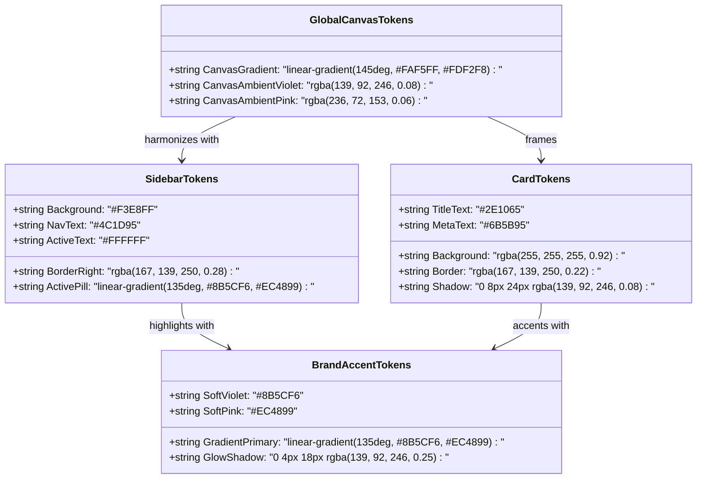

# Phase 1 Data Model: UI Theme State & Token Schema

**Feature**: `002-dreamy-pastel` | **Date**: 2026-11-16

---

## 1. UI Theme System Entities

While this feature does not alter relational SQL database tables, it defines the structured runtime design token model and reactive UI component states across the Blazor frontend.

### Design Token Hierarchy

---

## 2. Component State Mapping

### Home View (`Index.razor`) State

| State Property | Type | Description |
| :--- | :--- | :--- |
| `SearchQuery` | `string` | Live search query typed into the pastel search bar |
| `SelectedFilter` | `string` | Active category pill (`"All"`, `"Trending"`, `"Korean Drama"`, `"Thai BL"`, `"Movies"`) |
| `CurrentHeroSlide` | `int` | Current slide index in the multi-slide hero carousel (0..3) |
| `ToastMessage` | `string?` | Floating reactive notification string |
| `IsToastVisible` | `bool` | Visibility toggle for floating feedback pill |

### Sidebar Navigation (`NavMenu.razor`) State

| State Property | Type | Description |
| :--- | :--- | :--- |
| `WatchCount` | `int` | Live count of watch-later items displayed in soft-violet badge |
| `FavoriteCount` | `int` | Live count of favorited items displayed in soft-pink badge |
| `AuthService.CurrentUser` | `User` | Active authenticated user displaying in the sidebar user pill |
