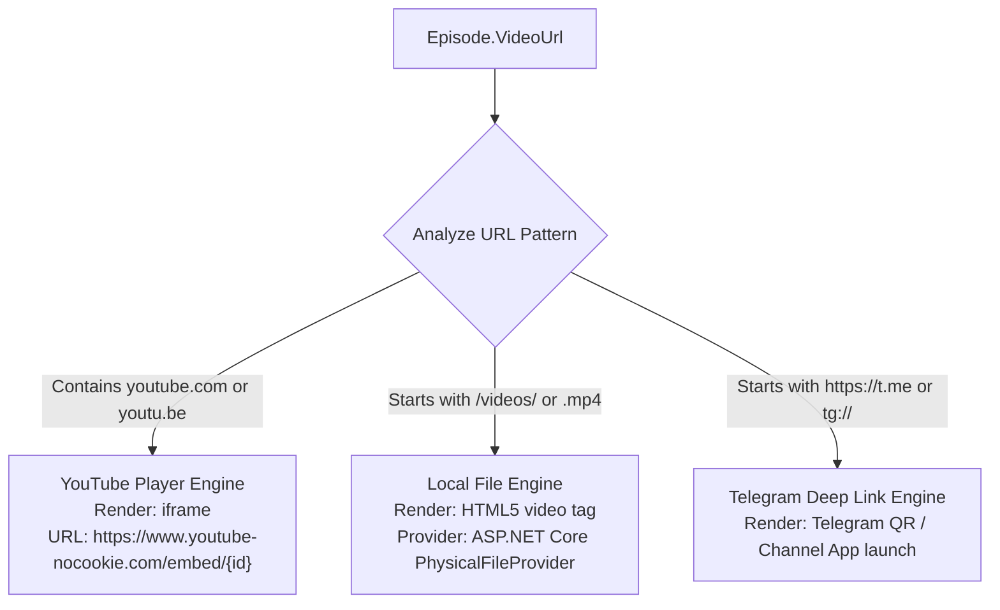

# Data Model: Local Media & Streaming Source

**Feature**: `003-local-youtube-episodes`  
**Status**: Ready  

---

## 1. Entity Definitions

### `Content` (Drama / Series / Movie Entity)
Represents a film or drama series catalog item.

| Field | Type | Nullable | Description |
|---|---|---|---|
| `ContentId` | `bigint` | No | Primary Key |
| `ContentTypeId` | `int` | No | Foreign key to `ContentType` (1 = Drama, 2 = Movie) |
| `Title` | `varchar(255)` | No | Name of the series/movie |
| `Description` | `nvarchar(max)` | Yes | Synopsis |
| `PosterUrl` | `varchar(500)` | Yes | Image URL or local path |
| `BannerUrl` | `varchar(500)` | Yes | Hero backdrop image URL |
| `ReleaseDate` | `date` | Yes | Year of release |
| `Country` | `varchar(100)` | Yes | e.g. South Korea, Thailand, Japan |
| `Language` | `varchar(100)` | Yes | e.g. Korean, Thai, Japanese |
| `Status` | `varchar(50)` | Yes | Ongoing, Completed |
| `IsDeleted` | `bit` | No | Soft-delete flag |

---

### `Episode` (Individual Video Entity)
Represents a playable episode or movie video stream.

| Field | Type | Nullable | Description |
|---|---|---|---|
| `EpisodeId` | `bigint` | No | Primary Key |
| `ContentId` | `bigint` | No | Foreign Key to `Content.ContentId` |
| `EpisodeNumber` | `int` | No | Sequential episode number (1, 2, 3...) |
| `Title` | `varchar(255)` | Yes | Episode title |
| `Description` | `nvarchar(max)` | Yes | Episode summary |
| `Duration` | `int` | Yes | Runtime in minutes |
| `VideoUrl` | `varchar(1000)` | No | Playable media source (see SourceType) |
| `ThumbnailUrl` | `varchar(500)` | Yes | Episode preview frame |
| `Status` | `varchar(50)` | No | "Active", "Processing", "Deleted" |

---

## 2. Media Source Type Resolution

The system dynamically resolves `VideoUrl` into one of three player rendering engines:

---

## 3. Physical Storage Folder Mapping on PC

| Content Title | ContentId | Physical Path on PC | Web Route Prefix | File Naming Pattern |
|---|---|---|---|---|
| **Alchemy of Souls** | `23` | `D:\Alchemy Of Soule S1+S2` | `/videos/alchemy-of-souls` | `video_2026-08-04_*.mp4` (1 to 30) |
| **Kingdom** | `20003` | `D:\KingDomS1+S2` | `/videos/kingdom` | `video_2026-07-17_*.mp4` (1 to 13) |
| **Daung With You** | `20004` | `D:\Daung With You` | `/videos/daung-with-you` | `EP{n} 1080P.mp4` (1 to 12) |
| **Fool In Love** | `20002` | `D:\Fool In Love` | `/videos/fool-in-love` | `EP{n} 1080P.mp4` (1 to 11) |
| **KhemJira** | `20005` | `D:\KhemJira` | `/videos/khemjira` | `EP{n} 720P/1080P.mp4` (1 to 12) |
