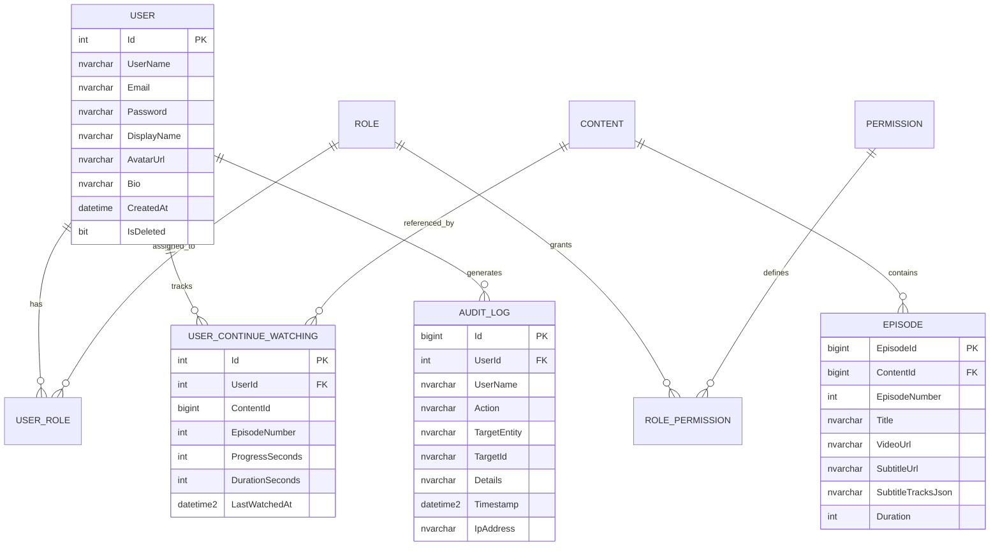

# Data Model: Platform Enhancements

**Feature Branch**: `004-platform-enhancements`  
**Date**: 2026-11-21  

This document defines the new and updated entities, relationships, validation rules, and schema changes required for the 5 platform features.

---

## 1. Entity Definitions & Schema Updates

### 1.1 `AuditLog` (New Table)
Records all sensitive administrative actions performed on movies, contents, episodes, users, and roles.

| Column Name | Data Type | Nullable | Description |
|---|---|---|---|
| `Id` | `BIGINT IDENTITY(1,1)` | No (PK) | Unique primary key for log entry |
| `UserId` | `INT` | No | ID of user/admin who performed the action |
| `UserName` | `NVARCHAR(100)` | No | Username of user/admin |
| `Action` | `NVARCHAR(50)` | No | E.g. `CREATE_CONTENT`, `DELETE_CONTENT`, `DELETE_MOVIE`, `ASSIGN_ROLE`, `CHANGE_PASSWORD` |
| `TargetEntity` | `NVARCHAR(50)` | No | Entity modified: `Movie`, `Content`, `Episode`, `User`, `Role` |
| `TargetId` | `NVARCHAR(100)` | Yes | Primary key or identifier of the affected entity |
| `Details` | `NVARCHAR(MAX)` | Yes | Human-readable explanation or JSON diff of changes |
| `Timestamp` | `DATETIME2` | No | UTC timestamp of event (Default: `SYSUTCDATETIME()`) |
| `IpAddress` | `NVARCHAR(50)` | Yes | Client IP address if available |

**Indexes**:
- `IX_AuditLog_Timestamp` (`Timestamp` DESC) - for timeline sorting.
- `IX_AuditLog_UserId` (`UserId`) - for per-user audit filtering.
- `IX_AuditLog_Action` (`Action`) - for action-type filtering.

---

### 1.2 `User` (Updated Table)
Add self-service profile fields to `User` table to persist custom avatars and profile bios.

| Column Name | Data Type | Nullable | Description |
|---|---|---|---|
| `AvatarUrl` | `NVARCHAR(500)` | Yes | URL or relative path to user profile image / preset avatar |
| `Bio` | `NVARCHAR(500)` | Yes | Optional short self-description or motto |

**Validation Rules**:
- `AvatarUrl`: Valid image URL or preset identifier (`/images/avatars/pastel-1.png`, etc.). Maximum 500 characters.
- `Password`: Minimum 6 characters. Hashed before storage.
- `Email`: Valid email format, unique across non-deleted users.

---

### 1.3 `Episode` (Updated Table / Model)
Add subtitle track metadata to support multi-language and Myanmar subtitle files.

| Column Name | Data Type | Nullable | Description |
|---|---|---|---|
| `SubtitleUrl` | `NVARCHAR(500)` | Yes | Path to default `.vtt` subtitle file (e.g., `/subtitles/ep1_my.vtt`) |
| `SubtitleTracksJson` | `NVARCHAR(MAX)` | Yes | JSON array of available subtitle tracks `[{"lang":"my","label":"Myanmar (မြန်မာ)","src":"..."}, {"lang":"en","label":"English","src":"..."}]` |

---

### 1.4 `UserContinueWatching` (Existing Table - Verified Fields)
Stores exact playback positions and timestamps for resumption.

| Column Name | Data Type | Nullable | Description |
|---|---|---|---|
| `Id` | `INT IDENTITY(1,1)` | No (PK) | Primary key |
| `UserId` | `INT` | No | User ID |
| `ContentId` | `BIGINT` | No | Content / Drama ID |
| `IsContent` | `BIT` | No | True for Content/Drama, False for standalone Movie |
| `Title` | `NVARCHAR(MAX)` | No | Content Title |
| `PosterUrl` | `NVARCHAR(MAX)` | Yes | Poster thumbnail |
| `Category` | `NVARCHAR(MAX)` | Yes | Category |
| `EpisodeNumber` | `INT` | No | Last watched episode number |
| `TotalEpisodes` | `INT` | No | Total episodes in series |
| `ProgressSeconds` | `INT` | No | Current playback timestamp in seconds (e.g. 872 = 14:32) |
| `DurationSeconds` | `INT` | No | Total media duration in seconds |
| `LastWatchedAt` | `DATETIME2` | No | UTC timestamp of last playback |
| `IsDeleted` | `BIT` | No | Soft-delete flag |

---

## 2. Multi-Facet Filter DTO (Category View)

```csharp
public class CategoryFilterCriteria
{
    public string CategoryName { get; set; } = "all";
    public string SearchQuery { get; set; } = string.Empty;
    public string ReleaseYear { get; set; } = "All"; // "All", "2026", "2025", "2024", "2023", "Older"
    public string Status { get; set; } = "All";      // "All", "Ongoing", "Completed"
    public double MinRating { get; set; } = 0.0;     // 0.0 (All), 7.0+, 8.0+, 9.0+
    public string SortBy { get; set; } = "year";     // "year", "rating", "title"
    public int PageNumber { get; set; } = 1;
    public int PageSize { get; set; } = 12;
}

public class PagedResult<T>
{
    public List<T> Items { get; set; } = new();
    public int TotalItems { get; set; }
    public int PageNumber { get; set; }
    public int PageSize { get; set; }
    public int TotalPages => (int)Math.Ceiling((double)TotalItems / (PageSize > 0 ? PageSize : 1));
    public bool HasPreviousPage => PageNumber > 1;
    public bool HasNextPage => PageNumber < TotalPages;
}
```

---

## 3. Entity Relationships Diagram


