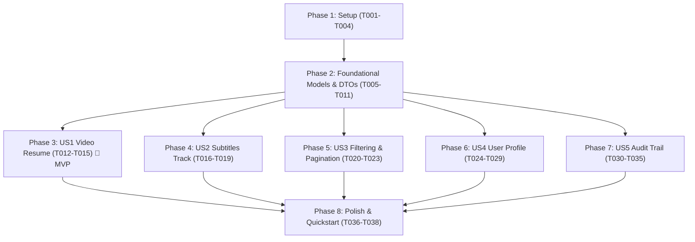

# Tasks: Platform Enhancements (Resume, Subtitles, Multi-Facet Filters, User Profile & Audit Trail)

**Input**: Design documents from `/specs/004-platform-enhancements/`  
**Prerequisites**: [plan.md](file:///C:/Users/Windows11/Desktop/Projects/Movie/specs/004-platform-enhancements/plan.md), [spec.md](file:///C:/Users/Windows11/Desktop/Projects/Movie/specs/004-platform-enhancements/spec.md), [research.md](file:///C:/Users/Windows11/Desktop/Projects/Movie/specs/004-platform-enhancements/research.md), [data-model.md](file:///C:/Users/Windows11/Desktop/Projects/Movie/specs/004-platform-enhancements/data-model.md), [contracts/](file:///C:/Users/Windows11/Desktop/Projects/Movie/specs/004-platform-enhancements/contracts/)

## Format: `- [ ] [TaskID] [P?] [Story?] Description with file path`

- **[P]**: Parallelizable task (independent file with no prerequisite blocking dependencies)
- **[Story]**: Associated user story tag (`[US1]` to `[US5]`)
- Every task includes explicit file paths and unambiguous implementation instructions.

---

## Phase 1: Setup (Shared Infrastructure)

**Purpose**: Project preparation and static assets initialization

- [X] T001 [P] Create SQL migration script `DotNetProject.Database/Scripts/002_platform_enhancements_migration.sql` defining `AuditLog` table (`Id`, `UserId`, `UserName`, `Action`, `TargetEntity`, `TargetId`, `Details`, `Timestamp`, `IpAddress`), and safe `IF NOT EXISTS` column additions for `User` (`AvatarUrl NVARCHAR(500) NULL`, `Bio NVARCHAR(500) NULL`) and `Episode` (`SubtitleUrl NVARCHAR(500) NULL`, `SubtitleTracksJson NVARCHAR(MAX) NULL`).
- [X] T002 [P] Create static WebVTT subtitles directory `DotNetProject.Balzor/wwwroot/subtitles/` and add sample Myanmar subtitle track `DotNetProject.Balzor/wwwroot/subtitles/sample_my.vtt` formatted in valid WebVTT UTF-8 format.
- [X] T003 [P] Create client JSInterop script `DotNetProject.Balzor/wwwroot/js/mediaPlayerInterop.js` with module methods `initPlayer`, `seekTo`, `getCurrentTime`, and `disposePlayer`.
- [X] T004 Configure WebVTT static file MIME type mapping (`.vtt` -> `text/vtt; charset=utf-8`) in `DotNetProject.Balzor/Program.cs`.

---

## Phase 2: Foundational (Blocking Prerequisites)

**Purpose**: Core database entity models, DTO contracts, and shared domain interfaces required across multiple user stories

**⚠️ CRITICAL**: Must complete before user story implementations start.

- [X] T005 [P] Create `DotNetProject.Database/AppDbModels/AuditLog.cs` entity model matching the `AuditLog` database table schema.
- [X] T006 [P] Update `DotNetProject.Database/AppDbModels/User.cs` to add profile properties: `public string? AvatarUrl { get; set; }` (max length 500) and `public string? Bio { get; set; }` (max length 500).
- [X] T007 [P] Update `DotNetProject.Database/AppDbModels/Episode.cs` to add subtitle properties: `public string? SubtitleUrl { get; set; }` (max length 500) and `public string? SubtitleTracksJson { get; set; }`.
- [X] T008 Register `DbSet<AuditLog> AuditLogs` and entity configurations in `DotNetProject.Database/AppDbModels/AppDbContext.cs`.
- [X] T009 [P] Create `DotNetProject.Domain/Features/Audit/AuditDto.cs` defining `AuditLogDto`, `AuditLogFilterRequest`, and `AuditLogCreateRequestModel`.
- [X] T010 [P] Create `DotNetProject.Domain/Features/Audit/IAuditInterface.cs` defining `Task LogActionAsync(...)` and `Task<PagedResult<AuditLogDto>> GetAuditLogsAsync(...)`.
- [X] T011 [P] Update `DotNetProject.Domain/Features/Users/UserDto.cs` with `UserProfileDto`, `UserProfileUpdateRequestModel`, `ChangePasswordRequestModel`, and `ChangePasswordResponseModel`.

**Checkpoint**: Foundation ready - all models and interfaces in place.

---

## Phase 3: User Story 1 - Video Resume & Timestamp Remembering (Priority: P1) 🎯 MVP

**Goal**: Seamlessly record video playback progress every 5 seconds via JSInterop and auto-seek on load/resume.

**Independent Test**: Play an episode in `DramaDetail.razor` to 01:25, navigate to Home, re-open the drama, and verify the video auto-seeks to 01:25 with a visual "Resumed from 01:25" confirmation.

- [X] T012 [P] [US1] Implement event listeners (`timeupdate` with 5s throttle, `pause`, `ended`, `loadedmetadata`) and `window.mediaPlayer` methods in `DotNetProject.Balzor/wwwroot/js/mediaPlayerInterop.js`.
- [X] T013 [US1] Add `RecordWatchProgressAsync(long contentId, int episodeNumber, int currentSeconds, int durationSeconds)` and `GetSavedTimestampAsync(long contentId, int episodeNumber)` in `DotNetProject.Balzor/Components/Shared/WatchHistoryService.cs`.
- [X] T014 [US1] Add `[JSInvokable] public async Task OnPlaybackProgress(int currentSeconds, int durationSeconds)` callback and auto-seek JSInterop invocation in `DotNetProject.Balzor/Components/Pages/Dramas/DramaDetail.razor.cs`.
- [X] T015 [US1] Update `<video>` markup in `DotNetProject.Balzor/Components/Pages/Dramas/DramaDetail.razor` with element ID `#mainVideoPlayer`, metadata event hookup, and resume notification badge/toast.

**Checkpoint**: User Story 1 (MVP) complete and independently functional.

---

## Phase 4: User Story 2 - Multi-Subtitle & Audio Track Support (Priority: P2)

**Goal**: Provide Myanmar subtitle (`.vtt`) track support in the video player with UTF-8 Unicode rendering and track switching.

**Independent Test**: Open an episode in `DramaDetail.razor` with an attached `.vtt` file, verify Myanmar subtitle track displays in player controls, and verify Burmese text renders accurately on screen.

- [X] T016 [P] [US2] Create Myanmar subtitle demo file `DotNetProject.Balzor/wwwroot/subtitles/alchemy_ep1_my.vtt` with valid WebVTT time-coded Burmese dialogue.
- [X] T017 [US2] Update `DramaDetail.razor.cs` in `DotNetProject.Balzor/Components/Pages/Dramas/DramaDetail.razor.cs` to resolve active subtitle tracks (`ActiveSubtitleUrl`, `AvailableSubtitles`) based on episode metadata with convention-based auto-discovery fallback (`/subtitles/{contentId}_ep{episodeNumber}_my.vtt`).
- [X] T018 [US2] Update `DotNetProject.Balzor/Components/Pages/Dramas/DramaDetail.razor` to render dynamic `<track kind="subtitles" label="Myanmar (မြန်မာ)" srclang="my" src="@ActiveSubtitleUrl" default />` elements and custom pastel subtitle toggle buttons.
- [X] T019 [P] [US2] Add custom styling in `DotNetProject.Balzor/Components/Pages/Dramas/DramaDetail.razor` (`::cue` pseudo-element) for Myanmar Unicode typography, font sizing, and translucent dark background.

**Checkpoint**: User Story 2 complete and independently functional.

---

## Phase 5: User Story 3 - Advanced Filtering & Pagination in Category View (Priority: P3)

**Goal**: Provide multi-facet catalog filtering (Release Year, Status Ongoing/Completed, Rating) and paginated navigation in `CategoryView.razor`.

**Independent Test**: Navigate to `/dramas/category/all`, filter by Year `2024`, Status `Completed`, Rating `8.0+`, verify matching count updates in real-time, and navigate through pages using pagination buttons.

- [X] T020 [P] [US3] Add `public string Status { get; set; } = "Completed";` to `CategoryItemDto`, and add `CategoryFilterCriteria` and `PagedResult<T>` support models to `DotNetProject.Balzor/Components/Pages/Dramas/CategoryView.razor.cs`.
- [X] T021 [US3] Update `CategoryView.razor.cs` with filter properties (`SelectedYear`, `SelectedStatus`, `SelectedMinRating`), multi-facet filtering pipeline in `ApplyFilters()` supporting preset year pills (2026, 2025, 2024, 2023, 2022, 'Older') and rating thresholds (9+, 8+, 7+, All), and pagination handlers (`GoToPage`, `NextPage`, `PreviousPage`, `TotalPages`).
- [X] T022 [US3] Update `DotNetProject.Balzor/Components/Pages/Dramas/CategoryView.razor` to render the multi-facet filter bar (Year pills, Status pills, Rating dropdown) and clean pagination navigation controls (`[Prev]` `[1]` `[2]` ... `[Next]`).
- [X] T023 [P] [US3] Style filter bar, facet pills, and pagination buttons in `DotNetProject.Balzor/Components/Pages/Dramas/CategoryView.razor.css` following the Dreamy Light Pastel theme tokens.

**Checkpoint**: User Story 3 complete and independently functional.

---

## Phase 6: User Story 4 - Self-Service User Profile & Password Change (Priority: P4)

**Goal**: Empower users to update their profile avatar, bio, and securely change their password on a dedicated `/profile` page.

**Independent Test**: Navigate to `/profile`, upload a new avatar image, update display name, enter current password and a new valid password, submit, then verify successful login with the new password.

- [X] T024 [P] [US4] Implement `UploadAvatarAsync(int userId, IFormFile file)` using `FileStorageService`, `UpdateProfileAsync(UserProfileUpdateRequestModel model)`, and `ChangePasswordAsync(ChangePasswordRequestModel model)` in `DotNetProject.WebApi/Features/Users/UserServices.cs`.
- [X] T025 [US4] Expose `GET /api/user/profile/{id}`, `POST /api/user/profile/avatar`, `PUT /api/user/profile`, and `POST /api/user/change-password` endpoints in `DotNetProject.WebApi/Features/Users/UserController.cs`.
- [X] T026 [P] [US4] Add profile API methods (`GetProfileAsync`, `UploadAvatarAsync`, `UpdateProfileAsync`, `ChangePasswordAsync`) in `DotNetProject.Balzor/Components/Shared/HttpClientServies.cs`.
- [X] T027 [US4] Create `DotNetProject.Balzor/Components/Pages/Auth/Profile.razor` with Dreamy Pastel card layout, file upload `<InputFile>` avatar selector with instant preview, bio editor, and password change form with validation.
- [X] T028 [US4] Implement logic, state binding, error handling, and toast feedback in `DotNetProject.Balzor/Components/Pages/Auth/Profile.razor.cs`.
- [X] T029 [P] [US4] Add profile navigation link with user avatar badge to `DotNetProject.Balzor/Components/Layout/NavMenu.razor`.

**Checkpoint**: User Story 4 complete and independently functional.

---

## Phase 7: User Story 5 - Activity Log & Audit Trail (Priority: P5)

**Goal**: Automatically record administrative actions and display a searchable, filterable Audit Trail in `/admin/audit-logs`.

**Independent Test**: Delete or edit a movie in Admin portal, navigate to `/admin/audit-logs`, verify the action entry appears with Admin username, action type, target ID, and timestamp; verify non-admin access is restricted.

- [X] T030 [P] [US5] Implement `AuditServices` implementing `IAuditInterface` in `DotNetProject.WebApi/Features/Audit/AuditServices.cs` for logging actions and querying paginated audit logs.
- [X] T031 [US5] Create `DotNetProject.WebApi/Features/Audit/AuditController.cs` with `GET /api/audit` and `POST /api/audit` endpoints.
- [X] T032 [US5] Create `AuditLogService` in `DotNetProject.Balzor/Components/Shared/AuditLogService.cs` to dispatch audit log records and query audit logs via HTTP client.
- [X] T033 [US5] Integrate audit logging in Admin mutation points:
  - `AdminMovieDelete.razor.cs` / `AdminMovies.razor.cs` (log `DELETE_MOVIE`)
  - `AdminContentDelete.razor.cs` / `AdminContents.razor.cs` (log `DELETE_CONTENT`)
  - `AdminRoles.razor.cs` / `AdminUsers.razor.cs` (log `ASSIGN_ROLE` / `REVOKE_ROLE`)
- [X] T034 [US5] Create `DotNetProject.Balzor/Components/Pages/Admin/AdminAuditLogs.razor` and `AdminAuditLogs.razor.cs` with action filter, user filter, date range filter, and paginated log table styled in Dreamy Pastel admin theme.
- [X] T035 [P] [US5] Add "Audit Trail" navigation link in `DotNetProject.Balzor/Components/Layout/NavMenu.razor` protected by `CanViewAuditLogs` or Admin permission check.

**Checkpoint**: User Story 5 complete and independently functional.

---

## Phase 8: Polish & Cross-Cutting Concerns

**Purpose**: System integration, styling consistency, and end-to-end verification

- [X] T036 [P] Verify all new components adhere to Dreamy Light Pastel design tokens (`--color-lavender`, `--color-mint`, `--color-peach`, `--color-soft-bg`) and responsive mobile breakpoints.
- [X] T037 [P] Perform complete quickstart validation following [quickstart.md](file:///C:/Users/Windows11/Desktop/Projects/Movie/specs/004-platform-enhancements/quickstart.md) across all 5 user scenarios.
- [X] T038 Clean up debug console logs and format all newly introduced C# and Razor files.

---

## Dependencies & Execution Order

### User Story Dependencies
- **US1 (Video Resume)**: Depends only on Foundational (Phase 2).
- **US2 (Subtitles Track)**: Depends only on Foundational (Phase 2). Integrates with player `<video>` component.
- **US3 (Filtering & Pagination)**: Depends only on Foundational (Phase 2). Operates in `CategoryView.razor`.
- **US4 (User Profile)**: Depends only on Foundational (Phase 2). Operates in `Profile.razor` and `UserController`.
- **US5 (Audit Trail)**: Depends only on Foundational (Phase 2). Operates in `AdminAuditLogs.razor` and admin action handlers.

---

## Parallel Opportunities

- **Setup & Foundational**: T001, T002, T003 can execute in parallel. T005, T006, T007, T009, T010, T011 can execute in parallel.
- **Across Stories**: Once Phase 2 completes, all 5 User Stories can be developed independently or in parallel.
- **Within Stories**:
  - In US1: JSInterop `mediaPlayerInterop.js` (T012) can be built in parallel with backend `WatchHistoryService` (T013).
  - In US2: Subtitle sample file (T016) and CSS styling (T019) can be created in parallel with C# logic (T017).
  - In US3: CSS styling (T023) can be built in parallel with DTOs (T020) and filter algorithms (T021).
  - In US4: WebApi service/controller (T024, T025) and Blazor page/UI (T027, T029) can be developed concurrently.
  - In US5: WebApi service/controller (T030, T031) and Blazor UI (T034, T035) can be developed concurrently.

---

## Implementation Strategy

### 1. MVP First (User Story 1 Only)
1. Complete Phase 1: Setup (T001 - T004)
2. Complete Phase 2: Foundational (T005 - T011)
3. Complete Phase 3: User Story 1 (T012 - T015)
4. **Validate MVP**: Play an episode, exit, reopen, and verify auto-seek works cleanly.

### 2. Incremental Delivery
- Add **US2 (Subtitles)**: Enables Myanmar subtitles on the player.
- Add **US3 (Category Filtering & Pagination)**: Powers fast content discovery.
- Add **US4 (User Profile)**: Delivers self-service avatar and password change.
- Add **US5 (Audit Trail)**: Solidifies enterprise administration and audit governance.
- Final Polish & Quickstart validation.
